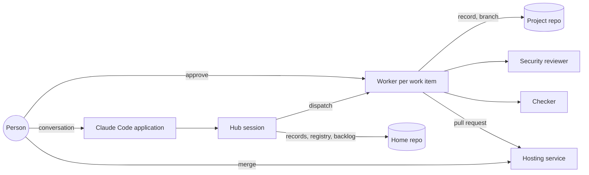

# Architecture

Identifiers such as O10 are the open design points (architecture, Open design points); identifiers such as A5 are the
assumptions (architecture, Assumptions to verify). Terms are defined in the [vision](../00-vision/VISION.md) glossary.

## Key facts

- **Host:** the machine where the installation's sessions run. It holds the home and the clones of the registered
  projects, and the kit as an installed plugin. Nothing in the design depends on which machine it is; the kit's README
  says where it has been tried.
- **Hub:** a Claude Code session whose working directory is the home repository, with the procedure of the kit's agent
  `honsha:hub`.
- **Conversation:** the Claude Code application, where the person talks with the hub and with each worker, and gives
  an approval in the worker's own session (workflow, Procedure).
- **Execution:** one worker session per work item, in a git worktree of the project, with that project's profile.
- **State:** Markdown files with front matter, in git. The home holds the hub's records, each project holds its own.
  Questions are answered from their front matter (architecture, Files).
- **Outputs:** branches and pull requests, on the service that hosts the repositories, which each installation
  chooses (workflow, The hosting service). Sessions never merge (architecture, Security).
- **Built from:** native Claude Code features first (architecture, Native first). The custom code is the hooks'
  scripts, the checks and the hub's scripts.

---

## Components

| Component         | Role                                                                                                                                                                                           | Built from                                                                                     |
| ----------------- | ---------------------------------------------------------------------------------------------------------------------------------------------------------------------------------------------- | ---------------------------------------------------------------------------------------------- |
| Host              | Holds the home and the projects' clones, and runs the sessions                                                                                                                                 | A machine of the person's                                                                      |
| Hub session       | Answers about the projects, captures requests in the backlog, adds projects and moves them between states, starts each work item's worker and follows it. Never edits project code itself      | The kit's agent `honsha:hub`, in a Claude Code session in the home                             |
| Application       | The person's conversations with the hub and with each worker; an approval is given in the worker's own session                                                                                 | The Claude Code application                                                                    |
| Worker            | Executes one work item in a worktree of its project and opens the pull request                                                                                                                 | A Claude Code session that the hub starts in a worktree, with the procedure of `honsha:worker` |
| Checker           | Verifies a finished work item against its record and the profile's gates, from a fresh context, read-only                                                                                      | Subagent defined in the kit                                                                    |
| Security reviewer | Looks for security holes in a change that touches what an attacker aims at, from a fresh context, read-only, given the change and not the worker's account of it                               | Subagent defined in the kit                                                                    |
| Hooks             | Give each session the core rules, the record template, its lessons, the installation's models and its procedure when it starts; guard its shell commands; write the effort level into a record | The plugin's hooks, scripts run by Node.js (architecture, Kit)                                 |
| Scripts           | The checks that the worker and the pipeline run, and the hub's scripts that keep the registry and the backlog                                                                                  | Node.js scripts of the kit, which import no package (interface, Commands)                      |
| Hosting identity  | Pushes branches and opens pull requests in the registered repositories; never merges                                                                                                           | An account or token on the hosting service                                                     |



---

## Repositories

Three kinds. The split between the first two is what keeps a user's content out of the template.

### Kit

The template, shared by every installation. Indicative layout:

```
.claude-plugin/        plugin manifest and marketplace manifest
rules/                 the always-on rules, in parts of one topic each
skills/                parallel parts, a branch update, an assessment, dependencies, the periodic review, the security posture, a security review, security testing
agents/                hub, worker, checker, security reviewer
hooks/                 session and checker start, the installation's models, and the hub's or the worker's procedure; the guard on shell commands; write the effort level into records
checks/                run a profile's verification commands; check a work branch's record and commits, and the default branch's commits; scan a repository's whole history for secrets; pin the release programs that the checks run; the kit's own static security testing
hub/                   the hub's code: the registry of projects, the moves between their states, the backlog
services/<name>/       what is specific to one hosting service: commands, settings, wiring of the checks
templates/             record, profile
docs/                  vision and specifications
work/                  the kit's own work records
.hub/profile.yml       the kit's own profile
```

- It is distributed as a Claude Code plugin from the kit's own repository, which is public. The repository is its own
  marketplace: the plugin is the repository root.
- Each host installs the plugin once, for the user that runs the installation's sessions, from the marketplace on the
  kit's hosting service, with automatic updates, and with the plugin's setting `home`, the home's folder on the host.
  No project holds a file for the kit. A host registers one source for a marketplace's name, for all its projects, so
  a second source, such as a clone's folder, would replace the first for every one of them. A session therefore runs
  under the kit as merged; an unmerged change to the kit is tried in a session started with `--plugin-dir`, as the
  kit's README says.
- The platform runs a plugin installed for the user in every session of that user, so each of the kit's hooks first
  places the session's folder (`hooks/place.mjs`): the home's main working tree, a worktree of the home, the folder
  that the home's registry, on its default branch as last fetched, gives a project on this host, or a worktree of
  that folder. Anywhere else the kit gives nothing and refuses nothing. On a host whose user runs only the
  installation's sessions, every folder is one of these; on a personal computer the test keeps the kit out of the
  person's other work. Where the home or its registry cannot be read, a session receives one line that says so, and
  the guard judges its commands as in a project.
- The manifests carry no `version`, so an installation that is updated moves to the repository's latest commit; with
  one, it would stay on its copy until the version changes (O10; architecture, Open design points).
- What an installation may rely on, and its documents may cite, is the kit's interface,
  `docs/01-specs/INTERFACE.md`: the names of the plugin, its agents and skills, the scripts' commands, the templates,
  the files the kit reads and writes, the registry's shape. It also says how it may change.
- What a piece of `services/<name>/` holds is the contract of a service's piece (workflow, The hosting service); the
  wiring of the checks sits where its service reads it.
- The plugin needs only Node.js to run: no hook and no check imports a package. The formatter, the linter and the
  type checker of the kit's own checks are development dependencies in `package.json`, at exact versions, installed
  from the lockfile without their install scripts. An installation of the plugin does not need them.
- It contains nothing about any user or project.
- It is itself a registered project: changes to it are work items like any other.
- An area pack is written only when a real work item needs it. A pack is the skill `area-<name>` of the kit,
  invoked as `honsha:area-<name>`.
- A session in a project cannot read the kit's files without a permission, because they lie outside the project. What
  every session needs is therefore put into its context when it starts: the core rules, in parts of one topic each, and
  the record template, each file by a hook of its own, since the platform caps each hook's output at 10,000 characters
  and replaces a longer one with a file path and a short preview. What a part near that cap, or a full total, calls for
  is said with the places a rule can go (workflow, Where the rules are). The checker, a subagent, receives the same
  files when it starts, from hooks matched to it alone. A session also receives the lessons of its project, its
  technologies and its host, one hook for each level, from the project and from the home that the plugin's setting
  `home` names (workflow, Lessons), and, from another hook, the models that the home's settings map to the kit's tiers
  (architecture, Models). A session that runs as no agent receives a procedure too, from a hook of its own:
  the hub's in the home's main working tree, the worker's in the home's worktrees and in the projects. The sessions
  that an application or another session starts run as no agent, and a session started as an agent has that agent's
  file as its system prompt.

### Home

One per user, private.

```
registry.yml           projects: name, repository, folder on each host, state, assessment, chosen items; written by hub/projects.mjs (workflow, Joining an installation)
settings.yml           max-workers, the workers a host runs at once, and models, the model of each of the kit's tiers
decisions.md           choices about this installation and standing preferences, those in force (workflow, Decisions)
inventory.md           accounts, credentials, hosts, connectors and plugins, by name, never by value (workflow, Accounts and credentials)
backlog/               work items not yet started, per project; written by hub/backlog.mjs (workflow, The backlog)
radar/                 one file per tool in use, with its review date, which the periodic review reads (honsha:review)
work/                  the home's work items: reports with their answers, outcomes of deferred checks, moves in the registry
lessons/tech/          one file per technology, shared by every project that uses it
lessons/host/          one file per host
.hub/profile.yml       the home's profile, as a project's (architecture, Project)
```

The home is a project like any other: the kit acts in it as in every project, and its default branch changes only
through pull requests that the person merges. The hub changes it only through work items, its own writes and those of
the kit's scripts included; a report is one of them, and its record holds the answer. The one exception is the
backlog: the kit's script pushes each record there and takes it out without a pull request, in commits that do nothing
else (core rules, Delivery; workflow, The backlog).

The home holds no instructions for the hub. A session opened in its own folder receives the procedure of the kit's
agent `honsha:hub` when it starts, from a hook of the kit; a session in a worktree of the home, where the home's own
items run, receives the worker's instead. The installation's choices that the hub applies, such as the language it
chats in, are entries of `decisions.md`.

### Project

Each registered repository. What the kit reads and writes in a project (interface, Files):

```
.hub/profile.yml       language, stack, areas with their paths, verification commands, quality gates
work/                  the project's work records
<lessons file>         the lessons about this repository, in the file that the profile names
```

The kit needs no file of its own in a project: its sessions receive it once the project is registered and has a
folder on the host (architecture, Kit). The project's `.gitignore` keeps out the platform's worktrees and the
checker's input files (`honsha:assessment`). A project's own rules, where it has any, are in the places the platform
reads, such as `CLAUDE.md` and `.claude/rules/`, and hold only what is specific to it.

A project's earlier workflow documents are deleted once its adoption no longer reads them; git keeps them (workflow,
Comments and documents).

### Files

**Files are the source of truth.** Every record is a Markdown file in git: readable, diffable, reviewable in a pull
request, usable without any service running.

**Questions are answered from front matter.** State, lists and history are read from the records' front matter (core
rules, The record), on the default branch and on the open branches, and the measures from git (`checks/measures.mjs`).
A scan of a thousand records' front matter takes tenths of a second.

**Two rules that keep the files manageable.**

- Records sit in folders by year and month (`work/2026/11/`). A hosting service's pages can stop listing a large
  folder: GitHub, for one, lists at most 1,000 entries per folder. The home's backlog is the exception,
  `backlog/<project>/`: it holds only what has not started, and a record leaves it when its item starts.
- No binary files among the records. A screenshot that a request carries is described in its record; the image stays
  outside the repository.

**What this does not cover.**

- Search by meaning. A question phrased with other words than the record's can miss; the hub retries with other terms.
- Scale beyond one user. Millions of records, or several people writing the same data at once, would need a database
  as the source of truth. Because records are structured, moving them into one is a script.

---

## Flows

### Ask

The hub answers about a project from its records, on its default branch and on its open branches, its open pull
requests and the measures of its merged items (`agents/hub.md`). A question that needs work, such as an audit, is a
report: a work item of the home, whose record holds the answer (workflow, Types).

### Dispatch

A request for work in a project is one work item and one pull request. The hub starts a worker's session for it in a
worktree of the project, on the tier and effort of its size, once the registry lets the item start (`agents/hub.md`).
From there to the merge, the steps are the workflow's (workflow, Procedure): a full item stops for the person's
approval, the security reviewer and the checker read the result where they apply, the worker opens the pull request,
and the person merges. Independent parts of a request run in parallel within its item, and independent requests at
the same time, within the limits of the host and the project (`honsha:parallel-parts`).

### Joining

A project joins an installation through its assessment and the items that the person chooses from it, and
`hub/projects.mjs` moves it between its states (workflow, Joining an installation).

### Review

On a date, or when the person asks, the periodic review reads every repository of the installation and reports: it
changes nothing, and what it finds becomes work items that the person chooses (`honsha:review`). It names the deferred
checks past their date, which the hub dispatches as reports of the home (workflow, Deferred checks).

---

## Native first

The kit is built from the platform's own pieces: a plugin with its hooks, agents and skills, sessions in worktrees,
and subagents. Custom code replaces a native piece only where it proves inadequate.

The hub must not depend on a conversation's memory: a session can be restarted at any time and resume from the files.

---

## Security

1. **Sessions never merge.** The rules and the kit's guard keep every session from merging, from pushing to the
   default branch and from force-pushing, on any service; what the guard does not stop is said
   with the guard (workflow, The guard). A hosting service may add protection of its own. Deploy credentials are
   not on the host.
2. **Nothing is installed by the hub.** Third-party skills, plugins and tools enter through a reviewed work item, with
   every file read, pinned to a commit.
3. **Sessions run with explicit permissions,** not with permission checks disabled.
4. **Accounts and credentials reach no further than their work.** A second factor on every account that can write,
   credentials narrow and expiring, a credential that deploys only for the default branch's runs, and every account,
   credential, host and connector listed in the home's inventory by name, never by value, and read again on a date
   (workflow, Accounts and credentials).

---

## Models

- The kit names four model tiers, from the lightest: light, standard, strong and strongest (core rules, Models), and
  no model. An installation maps each tier to a model under `models` in the home's `settings.yml`, by a name that the
  platform accepts both when it starts a session and when it starts a subagent; every session of the installation
  receives the map when it starts, from a hook (architecture, Kit). Which models exist, and which a plan makes
  affordable, change more often than the rule; the model that a name stands for on a provider is the platform's own
  setting.
- An item's session runs on the tier and effort of its size, which the hub gives it when it starts it
  (`agents/hub.md`). Most items are trivial or small, one concern with a clear acceptance, which a standard model at
  high effort does well; a small item where the hub sees a risk takes the strong tier at the same effort. Full items,
  which have more than one reasonable design or touch an interface or data, run on the strong tier at the higher
  effort. The strongest tier, or the highest effort, is used when a full item's work is too complex for the default:
  its strategy says so, the person approves that choice with it, and the hub then moves the item's session.
- The checker and the security reviewer run on the strong tier at least, at xhigh effort, and on the work's model and
  effort where those are higher: a cheaper model is safe for the work because a strong check follows it, and a check
  is never weaker than the work it reads. The platform lets a definition fix a model only by name, and takes an
  installation's map only when a subagent is started, so their definitions fix the effort and tell the session that
  starts them which model to name.
- An assessment runs on the strong tier at high effort: its findings choose the work that brings a project in, and it
  reads more than it reasons. The hub runs on the strong tier, the model the person starts it with.
- Every other subagent is started with its model named: a search, a lookup or a mechanical step on the light tier,
  since the session that asked reads its result; work that needs judgement on the session's own.
- A model or an effort given when a session or a subagent is started overrides its definition. The kit's agents name
  no model: a session that runs as the hub or the worker, or receives its procedure at start, runs on the model it was
  started with, the person's choice in the application or the one that the hub gives an item's session.
- Each record holds the model and the effort level of the session that did the work, and the measures count each
  model's tokens by item, its subagents' included, so the choice can be reviewed later with data. Who writes each is
  in the core rules (The record): the effort level reaches a hook after an edit, the model reaches no hook. The policy
  is revisited with that data, or when usage limits are reached.

---

## Assumptions to verify

| ID  | Assumption                                                                                                                 | If false                                                                  |
| --- | -------------------------------------------------------------------------------------------------------------------------- | ------------------------------------------------------------------------- |
| A5  | Where a hosting service offers it, the hub's identity can push branches and open pull requests without being able to merge | The rules and the guard remain the only stop against a merge by a session |

**Where they are tested.** A5 on each hosting service: its piece says what the service can enforce (workflow, The
hosting service).

---

## Open design points

| ID  | Point                                                               | Direction                                                                                                                                                                     |
| --- | ------------------------------------------------------------------- | ----------------------------------------------------------------------------------------------------------------------------------------------------------------------------- |
| O10 | Whether and when the plugin and marketplace manifests get a version | Add one when a change to the kit must not reach every installation at once; or, with no version, pin the installation that must wait to a tag or a commit (architecture, Kit) |

Points that concern one installation only (which host, which provider, when to order it, where personal documents
live) are not recorded here. They belong in that installation's home.
