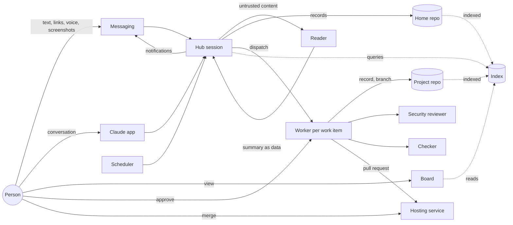

# Architecture

Identifiers such as O02 are the open design points (architecture, Open design points); identifiers such as A1 are the
assumptions (architecture, Assumptions to verify). Terms are defined in the [vision](../00-vision/VISION.md) glossary.

## Key facts

- **Host:** one always-on Linux VPS. It holds clones of the kit, the home and every registered project. A first
  installation can run on the person's own computer; nothing in the design depends on which machine it is.
- **Hub:** a long-lived Claude Code session whose working directory is the home repository, with the procedure of the
  kit's agent `honsha:hub`.
- **Channels:** a messaging app for capture, quick questions and notifications; the Claude app, where the person gives
  an approval in the worker's own session, and a board page for everything longer.
- **Execution:** one worker session per work item, in a git worktree of the project, with that project's profile.
- **State:** Markdown files with front matter, in git. The home holds the hub's records, each project holds its own. The
  files are the source of truth, not the query engine: questions go through a derived index (architecture, Files and
  index).
- **Outputs:** branches and pull requests, on the service that hosts the repositories, which each installation
  chooses (workflow, The hosting service). Sessions never merge (architecture, Security).
- **Built from:** native Claude Code features first. Custom code is limited to a scheduler, an index and a board, and to
  replacing a native piece only where it proves inadequate.

---

## Components

| Component         | Role                                                                                                                                                             | Built from                                                         |
| ----------------- | ---------------------------------------------------------------------------------------------------------------------------------------------------------------- | ------------------------------------------------------------------ |
| Host              | Runs everything; reachable without any personal device                                                                                                           | Linux VPS                                                          |
| Hub session       | Understands the three verbs (evaluate, ask, dispatch). Reads and writes the home. Never edits project code itself                                                | The kit's agent `honsha:hub`, in a Claude Code session in the home |
| Messaging         | Text, links, voice notes and screenshots in; replies and notifications out, among them where an approval waits; allowlisted senders only                         | Claude Code Channels (research preview)                            |
| App access        | Full conversations with the hub and with any worker, from phone or browser                                                                                       | Remote Control in server mode                                      |
| Worker            | Executes one work item in a worktree of its project and opens the pull request                                                                                   | Background session (research preview)                              |
| Reader            | Reads untrusted content: pages, transcripts, third-party repositories. Read-only tools, no secrets, no repository access                                         | Subagent defined in the kit                                        |
| Checker           | Verifies a finished work item against its record and the profile's gates, from a fresh context, read-only                                                        | Subagent defined in the kit                                        |
| Security reviewer | Looks for security holes in a change that touches what an attacker aims at, from a fresh context, read-only, given the change and not the worker's account of it | Subagent defined in the kit                                        |
| Scheduler         | Starts timed runs: checks that are due, radar reviews, proactive research                                                                                        | Timers on the host (custom, small)                                 |
| Board             | Shows projects, open work items, live sessions and pending approvals; links into the app for conversation                                                        | Page generated from the index and session state (custom, small)    |
| Index             | Answers "which records" questions for the hub and the board: metadata of every record and full-text search                                                       | A SQLite file built from the records by a script (custom, small)   |
| Hosting identity  | Pushes branches and opens pull requests in the registered repositories; never merges                                                                             | An account or token on the hosting service                         |



---

## Repositories

Three kinds. The split between the first two is what keeps a user's content out of the template.

### Kit

The template, shared by every installation. Indicative layout:

```
.claude-plugin/        plugin manifest and marketplace manifest
rules/                 the always-on rules, in parts of one topic each
skills/                workflow, triage, radar, status, one pack per area; parallel parts, a branch update, an assessment, dependencies, the periodic review, the security posture, a security review, security testing
agents/                hub, worker, reader, checker, security reviewer
hooks/                 session and checker start, the installation's models, and the hub's or the worker's procedure; the guard on shell commands; write the effort level into records
checks/                run a profile's verification commands; check a work branch's record and commits, and the default branch's commits; scan a repository's whole history for secrets; pin the release programs that the checks run; the kit's own static security testing
hub/                   the hub's code: the registry of projects, the moves between their states, the backlog
services/<name>/       what is specific to one hosting service: commands, settings, wiring of the checks
templates/             record, inbox item, radar entry, profile
board/                 the board generator
docs/                  vision and specifications
work/                  the kit's own work records
.hub/profile.yml       the kit's own profile
```

- It is distributed as a Claude Code plugin from the kit's own repository, which is public. The repository is its own
  marketplace: the plugin is the repository root.
- Each host installs the plugin once, for the user that runs the installation's sessions, from the marketplace on the
  kit's hosting service, with automatic updates, and with the plugin's setting `home`, the home's folder on the host.
  No project holds a file for the kit. A host registers one source for a marketplace's name, for all its projects, so
  a second source, such as a clone's folder, would replace the first for every one of them. A session therefore runs
  under the kit as merged; an unmerged change to the kit is tried in a session started with `--plugin-dir`, as the
  kit's README says.
- The platform runs a plugin installed for the user in every session of that user, so each of the kit's hooks first
  places the session's folder (`hooks/place.mjs`): the home's main working tree, a worktree of the home, the folder
  that the home's registry, on its default branch as last fetched, gives a project on this host, or a worktree of
  that folder. Anywhere else the kit gives nothing and refuses nothing. On the always-on host, whose user runs only
  the installation's sessions, every folder is one of these; on a personal computer the test keeps the kit out of the
  person's other work. Where the home or its registry cannot be read, a session receives one line that says so, and
  the guard judges its commands as in a project.
- The manifests carry no `version`, so an installation that is updated moves to the repository's latest commit; with
  one, it would stay on its copy until the version changes (O10; architecture, Open design points).
- What an installation may rely on, and its documents may cite, is the kit's interface,
  `docs/01-specs/INTERFACE.md`: the names of the plugin, its agents and skills, the scripts' commands, the templates,
  the files the kit reads and writes, the registry's shape. It also says how it may change.
- What a piece of `services/<name>/` holds is the contract of a service's piece (workflow, The hosting service); the
  wiring of the checks sits where its service reads it.
- The plugin needs only Node.js to run: no hook and no check imports a package. The formatter, the linter and the
  type checker of the kit's own checks are development dependencies in `package.json`, at exact versions, installed
  from the lockfile without their install scripts. An installation of the plugin does not need them.
- It contains nothing about any user or project.
- It is itself a registered project: changes to it are work items like any other.
- An area pack is written only when a real work item needs it. A pack is the skill `area-<name>` of the kit,
  invoked as `honsha:area-<name>`.
- A session in a project cannot read the kit's files without a permission, because they lie outside the project. What
  every session needs is therefore put into its context when it starts: the core rules, in parts of one topic each, and
  the record template, each file by a hook of its own, since the platform caps each hook's output at 10,000 characters
  and replaces a longer one with a file path and a short preview. What a part near that cap, or a full total, calls for
  is said with the places a rule can go (workflow, Where the rules are). The checker, a subagent, receives the same
  files when it starts, from hooks matched to it alone. A session also receives the lessons of its project, its
  technologies and its host, one hook for each level, from the project and from the home that the plugin's setting
  `home` names (workflow, Lessons), and, from another hook, the models that the home's settings map to the kit's tiers
  (architecture, Models). A session that runs as no agent receives a procedure too, from a hook of its own:
  the hub's in the home's main working tree, the worker's in the home's worktrees and in the projects. The sessions
  that an application or another session starts run as no agent, and a session started as an agent has that agent's
  file as its system prompt.

### Home

One per user, private.

```
registry.yml           projects: name, repository, folder on each host, state, assessment, chosen items; written by hub/projects.mjs (workflow, Joining an installation)
settings.yml           quiet period, notification rules, allowlisted senders, worker limit per host, models of the kit's tiers
hosts.yml              hosts and their capabilities
decisions.md           choices about this installation and standing preferences, those in force (workflow, Decisions)
inventory.md           accounts, credentials, hosts, connectors and plugins, by name, never by value (workflow, Accounts and credentials)
inbox/                 one file per item received, with its verdict
backlog/               work items not yet started, per project; written by hub/backlog.mjs (workflow, The backlog)
radar/                 one file per tool
work/                  the home's work items: reports with their answers, outcomes of deferred checks, moves in the registry
lessons/tech/          one file per technology, shared by every project that uses it
lessons/host/          one file per host
.hub/profile.yml       the home's profile, as a project's (architecture, Project)
```

The home is a project like any other: the kit acts in it as in every project, and its default branch changes only
through pull requests that the person merges. The hub changes it only through work items, its own writes and those of
the kit's scripts included; a report is one of them, and its record holds the answer. The one exception is the
backlog: the kit's script pushes each record there and takes it out without a pull request, in commits that do nothing
else (core rules, Delivery; workflow, The backlog).

The home holds no instructions for the hub. A session opened in its own folder receives the procedure of the kit's
agent `honsha:hub` when it starts, from a hook of the kit; a session in a worktree of the home, where the home's own
items run, receives the worker's instead. The installation's choices that the hub applies, such as the language it
chats in, are entries of `decisions.md`.

### Project

Each registered repository. What the kit adds to a project:

```
.hub/profile.yml       language, stack, areas with their paths, verification commands, quality gates, data sources, playbooks
work/                  the project's work records
CLAUDE.md              short; names the profile and anything truly project-specific
.claude/rules/         project-specific rules, scoped by path
```

The kit needs no file of its own in a project: its sessions receive it once the project is registered and has a
folder on the host (architecture, Kit). The project's `.gitignore` keeps out the platform's worktrees and the
checker's input files (`honsha:assessment`).

Existing workflow documents in a project stay where they are as legacy and are not converted.

### Files and index

**Files are the source of truth.** Every record is a Markdown file in git: readable, diffable, reviewable in a pull
request, usable without any service running.

**Files are not the query engine.** An agent never finds a record by reading files one after another. It asks the
index, receives a few paths, and reads only those. The cost of a question in tokens then stays the same whether there
are five hundred records or fifty thousand.

**The index** is one SQLite file per host:

- a table with the front matter of every record, from the home and from every registered project;
- full-text search over the bodies;
- built by a script from the files, refreshed from what changed since the last run;
- disposable: not in git, never edited by hand, rebuilt from scratch at any time.

It also feeds the board. It is not needed on the first day: with a thousand records a direct scan of the files takes
tenths of a second. At 50,000 records a scan of the front matter takes seconds, while the index answers in
milliseconds. It is built with the board.

**Two rules that keep the files manageable.**

- Records sit in folders by year and month (`inbox/2026/11/`, `work/2026/11/`). A hosting service's pages can stop
  listing a large folder: GitHub, for one, lists at most 1,000 entries per folder. The home's backlog is the exception,
  `backlog/<project>/`: it holds only what has not started, and a record leaves it when its item starts.
- No binary files in git. A voice note or a screenshot is stored as its transcript or description in the record. The
  original stays outside the repository, with a retention period.

**What this does not cover.**

- Search by meaning. A question phrased with other words than the record's can miss. The hub retries with other terms;
  a semantic index is added only if misses become a real problem.
- Scale beyond one user. Millions of records, or several people writing the same data at once, would need a database
  as the source of truth. Because records are structured, moving them into one is a script.

---

## Flows

### Evaluate

1. An item arrives by message. The hub writes it to `inbox/` as received.
2. The reader fetches what official means allow and returns a summary. If the subject cannot be identified, the
   hub asks for one line.
3. The hub researches the primary source of the thing shown, through the reader, and judges it against the registry
   and the radar.
4. The verdict (Adopt, Trial, Watch, Ignore), its flags and its evidence level are written to the item's file and sent
   back.
5. Adopt or Trial produces a proposal: a radar change, or a draft work item in the home's backlog for a project or for
   the kit. Nothing is installed.

Proactive research is the same flow started by the scheduler, with items marked as found by the hub. It
proposes a few items a day at most (three by default) and notifies only Adopt and Trial verdicts; the rest is on the
board. Both limits are settings in the home.

### Ask

- **Status and history.** The hub queries the index (architecture, Files and index) and reads only the records it
  returns. Nothing is indexed by hand.
- **Operations questions** ("how did sales go last week"). The hub starts a read-only session in the project, which uses
  the data sources and playbooks named in the profile. The answer is stored as a report record.

### Dispatch

1. The hub identifies the project. One request is one work item and one pull request: the hub proposes its size and
   areas and creates the record in a new branch of the project (taken from the backlog with `hub/backlog.mjs take` if it
   was there). Parts of the request that are independent are run in parallel by the worker and integrated before
   verification (workflow, Parallel work). Separate requests that are independent of each other run at
   the same time, within the limits of the host and the project.
2. A full-size item stops here: the person approves the strategy in the worker's session. Trivial and small items
   continue.
3. A worker runs in a worktree with the profile, the core rules and the packs of the item's areas.
4. Where the change touches what an attacker aims at, the security reviewer looks for holes in it first. The checker
   verifies the result. Their reports go into the record and the pull request.
5. The pull request is opened and the person is notified. The person merges.

### Scheduled

The scheduler starts three kinds of run: checks whose date has come, written in the front matter of closed items;
reviews of radar entries; proactive research. All of them go through the hub and leave records.

---

## Native first

| Need                            | First version                     | Replaced by custom code if                                      |
| ------------------------------- | --------------------------------- | --------------------------------------------------------------- |
| Messaging in and out            | Channels with the Telegram plugin | Voice notes or images do not arrive, or a notice needs a button |
| Conversation from phone and web | Remote Control server mode        | It does not survive reboots or disconnections reliably          |
| Running work items              | Background sessions               | State cannot be read reliably by the board                      |
| Timed runs                      | Host timers that message the hub  | —                                                               |
| Board                           | A generated page                  | —                                                               |
| Isolation of untrusted content  | A restricted subagent             | Tool restrictions prove insufficient; then a separate process   |

The hub must not depend on a conversation's memory: a session can be restarted at any time and resume from the files.

---

## Security

1. **Untrusted content goes through the reader.** Pages, transcripts and third-party repositories are read by an agent
   with read-only tools and no secrets. What it returns is data, never instructions.
2. **Only allowlisted senders** can talk to the hub.
3. **Sessions never merge.** The rules and the kit's guard keep every session from merging, from pushing to the
   default branch and from force-pushing, on any service; what the guard does not stop is said
   with the guard (workflow, The guard). A hosting service may add protection of its own. Deploy credentials are
   not on the host.
4. **Project data is read-only.** Credentials for a project's data live on the host outside any repository and are
   given only to sessions of that project.
5. **Nothing is installed by the hub.** Third-party skills, plugins and tools enter through a reviewed work item, with
   every file read, pinned to a commit.
6. **The host is minimal.** Key-only SSH, a firewall, a dedicated user, automatic security updates, no public service
   unless the board needs one.
7. **Sessions run with explicit permissions,** not with permission checks disabled.
8. **Accounts and credentials reach no further than their work.** A second factor on every account that can write,
   credentials narrow and expiring, a credential that deploys only for the default branch's runs, and every account,
   credential, host and connector listed in the home's inventory by name, never by value, and read again on a date
   (workflow, Accounts and credentials).

---

## Models

- The kit names four model tiers, from the lightest: light, standard, strong and strongest (core rules, Models), and
  no model. An installation maps each tier to a model under `models` in the home's `settings.yml`, by a name that the
  platform accepts both when it starts a session and when it starts a subagent; every session of the installation
  receives the map when it starts, from a hook (architecture, Kit). Which models exist, and which a plan makes
  affordable, change more often than the rule; the model that a name stands for on a provider is the platform's own
  setting.
- An item's session runs on the tier and effort of its size, which the hub gives it when it starts it
  (`agents/hub.md`). Most items are trivial or small, one concern with a clear acceptance, which a standard model at
  high effort does well; a small item where the hub sees a risk takes the strong tier at the same effort. Full items,
  which have more than one reasonable design or touch an interface or data, run on the strong tier at the higher
  effort. The strongest tier, or the highest effort, is used when a full item's work is too complex for the default:
  its strategy says so, the person approves that choice with it, and the hub then moves the item's session.
- The checker and the security reviewer run on the strong tier at least, at xhigh effort, and on the work's model and
  effort where those are higher: a cheaper model is safe for the work because a strong check follows it, and a check
  is never weaker than the work it reads. The platform lets a definition fix a model only by name, and takes an
  installation's map only when a subagent is started, so their definitions fix the effort and tell the session that
  starts them which model to name.
- An assessment runs on the strong tier at high effort: its findings choose the work that brings a project in, and it
  reads more than it reasons. The hub runs on the strong tier, the model the person starts it with.
- Every other subagent is started with its model named: a search, a lookup or a mechanical step on the light tier,
  since the session that asked reads its result; work that needs judgement on the session's own.
- A model or an effort given when a session or a subagent is started overrides its definition. The kit's agents name
  no model: a session that runs as the hub or the worker, or receives its procedure at start, runs on the model it was
  started with, the person's choice in the application or the one that the hub gives an item's session.
- Each record holds the model and the effort level of the session that did the work, and the measures count each
  model's tokens by item, its subagents' included, so the choice can be reviewed later with data. Who writes each is
  in the core rules (The record): the effort level reaches a hook after an edit, the model reaches no hook. The policy
  is revisited with that data, or when usage limits are reached.

---

## Assumptions to verify

| ID  | Assumption                                                                                                                 | If false                                                                  |
| --- | -------------------------------------------------------------------------------------------------------------------------- | ------------------------------------------------------------------------- |
| A1  | Remote Control server mode runs on the host, starts sessions from the phone, and can be kept alive as a service            | App access is limited to attaching by SSH                                 |
| A2  | Channels delivers text, links, voice notes and images to the hub session and lets it reply                                 | A small custom bot replaces it                                            |
| A3  | The hub session can start a background session in another repository and read its state as JSON                            | A small launcher script on the host                                       |
| A5  | Where a hosting service offers it, the hub's identity can push branches and open pull requests without being able to merge | The rules and the guard remain the only stop against a merge by a session |
| A8  | A long-lived hub session stays usable over weeks                                                                           | A daily restart, with all state in files                                  |
| A9  | Voice notes can be transcribed on the host or through a service chosen on the radar                                        | Voice notes wait for a later version                                      |

**Where they are tested.** On a personal computer first: A2, A5, A9, and the functional part of A1 and A3. Only on
the always-on host: keeping A1 alive as a service, and A8. Background sessions are documented for macOS and Linux; on
Windows A3 is tried as it is, and falls back to WSL2 or waits for the host.

---

## Open design points

| ID  | Point                                                                 | Direction                                                                                                                                                                     |
| --- | --------------------------------------------------------------------- | ----------------------------------------------------------------------------------------------------------------------------------------------------------------------------- |
| O02 | Which credential timed runs use: the subscription login or an API key | An API key for anything started by a timer; the subscription for sessions the person drives                                                                                   |
| O06 | Board access: a private network, or a public address with a login     | A private network by default; the tool is chosen in each installation's radar                                                                                                 |
| O07 | Speech-to-text for voice notes: on the host or through a service      | No constraint in the design; chosen in each installation's radar                                                                                                              |
| O10 | Whether and when the plugin and marketplace manifests get a version   | Add one when a change to the kit must not reach every installation at once; or, with no version, pin the installation that must wait to a tag or a commit (architecture, Kit) |

Points that concern one installation only (which host, which provider, when to order it, where personal documents
live) are not recorded here. They belong in that installation's home.
