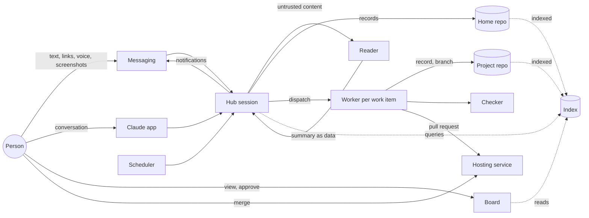

# Architecture

**Status:** approved as the starting base on 2026-11-16. Identifiers such as D21 or O02 refer to the author's decision log, which is kept outside this repository. Terms are defined in
the [vision](../00-vision/VISION.md) glossary.

Several parts rest on platform features that are research previews or were read from documentation and not yet tried.
They are listed as assumptions in section 8, and the plan starts by testing them.

## 1. Key facts

- **Host:** one always-on Linux VPS. It holds clones of the kit, the home and every registered project. A first
  installation can run on the person's own computer (D42); nothing in the design depends on which machine it is.
- **Hub:** a long-lived Claude Code session whose working directory is the home repository.
- **Channels:** a messaging app for capture, quick questions, approvals and notifications; the Claude app and a board
  page for everything longer.
- **Execution:** one worker session per work item, in a git worktree of the project, with that project's profile.
- **State:** Markdown files with front matter, in git. The home holds the hub's records, each project holds its own.
  The files are the source of truth, not the query engine: questions go through a derived index (section 3.4).
- **Outputs:** branches and pull requests, on the service that hosts the repositories. The identity the hub uses
  there cannot merge.
- **Hosting service:** each installation chooses the service that hosts its repositories and their pull requests.
  The kit does not depend on which one it is: its rules name no service, and anything specific to one service is a
  separate piece that another installation can replace with its own. So far the kit has been tried with GitHub
  only.
- **Built from:** native Claude Code features first. Custom code is limited to a scheduler, an index and a board, and to
  replacing a native piece only where it proves inadequate.

---

## 2. Components

| Component       | Role                                                                                                                  | Built from                                              |
| --------------- | --------------------------------------------------------------------------------------------------------------------- | ------------------------------------------------------- |
| Host            | Runs everything; reachable without any personal device                                                                | Linux VPS                                               |
| Hub session     | Understands the three verbs (evaluate, ask, dispatch). Reads and writes the home. Never edits project code itself     | Claude Code session with the kit loaded                 |
| Messaging       | Text, links, voice notes and screenshots in; replies, notifications and approvals out; allowlisted senders only       | Claude Code Channels (research preview)                 |
| App access      | Full conversations with the hub and with any worker, from phone or browser                                            | Remote Control in server mode                           |
| Worker          | Executes one work item in a worktree of its project and opens the pull request                                        | Background session (research preview)                   |
| Reader          | Reads untrusted content: pages, transcripts, third-party repositories. Read-only tools, no secrets, no repository access | Subagent defined in the kit                             |
| Checker         | Verifies a finished work item against its record and the profile's gates, from a fresh context, read-only             | Subagent defined in the kit                             |
| Scheduler       | Starts timed runs: checks that are due, radar reviews, proactive research                                             | Timers on the host (custom, small)                      |
| Board           | Shows projects, open work items, live sessions and pending approvals; links into the app for conversation             | Page generated from the index and session state (custom, small) |
| Index           | Answers "which records" questions for the hub and the board: metadata of every record and full-text search            | A SQLite file built from the records by a script (custom, small) |
| Hosting identity | Pushes branches and opens pull requests in the registered repositories; cannot merge                                 | Dedicated account or token, plus protected branches     |



---

## 3. Repositories

Three kinds. The split between the first two is what keeps a user's content out of the template (D28).

### 3.1 Kit (template, shared)

Indicative layout:

```
.claude-plugin/        plugin manifest and marketplace manifest
rules/core.md          the few always-on rules
skills/                workflow, triage, radar, status, one pack per area
agents/                worker, reader, checker
hooks/                 session start; the guard on shell commands; write the effort level into records
checks/                run a profile's verification commands; check the commits of a work branch
services/<name>/       what is specific to one hosting service: commands, settings, wiring of the checks
templates/             record, inbox item, radar entry, profile
board/                 the board generator
docs/                  vision and specifications
work/                  the kit's own work records
.hub/profile.yml       the kit's own profile
```

Built so far: the manifests, the core rules, the record template, the worker, the checker, the hooks, the checks,
the kit's own profile and the piece for GitHub. The rest of the layout is still indicative.

- It is distributed as a Claude Code plugin from a private marketplace repository. The repository is its own
  marketplace: the plugin is the repository root.
- The manifests carry no `version`. Claude Code then takes the commit as the version, so an installation that is
  updated moves to the repository's latest commit. With a `version` in the manifest, an installation stays on the
  copy it has until that string changes, however many commits follow: every release then has to raise the version,
  or no installation receives it. This is what the platform's documentation says: an installation from the
  marketplace has not been tried yet (section 8). Whether and when a version is added is an open point (section 9,
  O10). The same documentation gives a second way to hold an installation at a point, with no version: pinning it
  to a tag or a commit of this repository.
- What is specific to one hosting service sits in `services/<name>/`, apart from the rules; the wiring of the checks
  sits where that service reads it. `services/github/` is the only piece so far. What a piece holds is in
  [WORKFLOW.md](WORKFLOW.md), section 14.
- It contains nothing about any user or project.
- It is itself a registered project (D12): changes to it are work items like any other.
- An area pack is written only when a real work item needs it (D52). A pack is the skill `area-<name>` of the kit,
  invoked as `honsha:area-<name>`.
- A session in a project cannot read the kit's files without a permission, because they lie outside the project.
  What every session needs is therefore put into its context when it starts: the core rules and the record
  template. Together they must stay under 10,000 characters, the platform's limit for what a hook can deliver.

### 3.2 Home (one per user, private)

```
registry.yml           projects: name, repository, path on each host, state
settings.yml           quiet period, notification rules, allowlisted senders, worker limit per host
hosts.yml              hosts and their capabilities
inbox/                 one file per item received, with its verdict
backlog/               work items not yet started, per project
radar/                 one file per tool
reports/               answers to questions, and outcomes of deferred checks
lessons/tech/          one file per technology, shared by every project that uses it
lessons/host/          one file per host
```

The hub writes to the home directly. It is the only repository where it does.

### 3.3 Project (each registered repository)

What the kit adds to a project:

```
.hub/profile.yml       language, stack, areas with their paths, verification commands, quality gates, data sources, playbooks
work/                  the project's work records
CLAUDE.md              short; names the profile and anything truly project-specific
.claude/settings.json  declares the kit's marketplace and plugin; starts new worktrees from the current branch
.claude/rules/         project-specific rules, scoped by path
```

The project's settings set `worktree.baseRef` to `"head"`. The platform otherwise starts a new worktree from the
default branch, while the parts of a work item start from the item's branch ([WORKFLOW.md](WORKFLOW.md), section
13.6). This is what the platform's documentation says: it has not been tried yet.

Existing workflow documents in a project stay where they are as legacy and are not converted.

### 3.4 Files and index

**Files are the source of truth.** Every record is a Markdown file in git: readable, diffable, reviewable in a pull
request, usable without any service running.

**Files are not the query engine.** An agent never finds a record by reading files one after another. It asks the
index, receives a few paths, and reads only those. The cost of a question in tokens then stays the same whether there
are five hundred records or fifty thousand.

**The index** is one SQLite file per host:

- a table with the front matter of every record, from the home and from every registered project;
- full-text search over the bodies;
- built by a script from the files, refreshed from what changed since the last run;
- disposable: not in git, never edited by hand, rebuilt from scratch at any time.

It also feeds the board. It is not needed on the first day: with a thousand records a direct scan of the files takes
tenths of a second. It is built with the board.

**Two rules that keep the files manageable.**

- Records sit in folders by year and month (`inbox/2026/11/`, `work/2026/11/`). A hosting service's pages can stop
  listing a large folder: GitHub, for one, lists at most 1,000 entries per folder.
- No binary files in git. A voice note or a screenshot is stored as its transcript or description in the record. The
  original stays outside the repository, with a retention period.

**Measured** on a Windows PC on 2026-11-16, with 50,000 synthetic records (248 MB of text):

| Operation                                    | Scanning the files | Through the index |
| -------------------------------------------- | ------------------ | ----------------- |
| Open items of one project                    | 3.2 s              | 5 ms              |
| A rare word in the text                      | 3.4 s              | 1.4 ms            |
| Two common words, ten best matches           | —                  | 13 ms             |
| Counts by project, month and size            | —                  | 66 ms             |
| Building the index from scratch              | —                  | 9 s               |
| Finding the files changed since the last run | 1.6 s              | —                 |

The files had just been written, so the disk cache was warm; a cold first run will be slower. The text was random
words, not real records. At about 10,000 records a year, a high estimate for one person with several active projects,
50,000 records is roughly five years of use.

**What this does not cover.**

- Search by meaning. A question phrased with other words than the record's can miss. The hub retries with other terms;
  a semantic index is added only if misses become a real problem.
- Scale beyond one user. Millions of records, or several people writing the same data at once, would need a database
  as the source of truth. Because records are structured, moving them into one is a script.

---

## 4. Flows

### 4.1 Evaluate

1. An item arrives by message. The hub writes it to `inbox/` as received.
2. The reader fetches what official means allow (D16) and returns a summary. If the subject cannot be identified, the
   hub asks for one line.
3. The hub researches the primary source of the thing shown, through the reader, and judges it against the registry
   and the radar.
4. The verdict (Adopt, Trial, Watch, Ignore), its flags and its evidence level are written to the item's file and sent
   back.
5. Adopt or Trial produces a proposal: a radar change, or a draft work item in the home's backlog for a project or for
   the kit. Nothing is installed (D04).

Proactive research (D35) is the same flow started by the scheduler, with items marked as found by the hub. It
proposes a few items a day at most (three by default) and notifies only Adopt and Trial verdicts; the rest is on the
board (D51). Both limits are settings in the home.

### 4.2 Ask

- **Status and history.** The hub queries the index (section 3.4) and reads only the records it returns. Nothing is
  indexed by hand.
- **Operations questions** ("how did sales go last week"). The hub starts a read-only session in the project, which uses
  the data sources and playbooks named in the profile. The answer is stored as a report record.

### 4.3 Dispatch

1. The hub identifies the project. One request is one work item and one pull request (D47): the hub proposes its size
   and areas and creates the record in a new branch of the project (moved from the backlog if it was there). Parts of
   the request that are independent are run in parallel by the worker and integrated before verification
   ([WORKFLOW.md](WORKFLOW.md), section 5.1). Separate requests that are independent of each other run at the same
   time, within the limits of the host and the project.
2. A full-size item stops here: the strategy is sent for approval (D21). Trivial and small items continue (D32).
3. A worker runs in a worktree with the profile, the core rules and the packs of the item's areas.
4. The checker verifies the result. Its report goes into the record and the pull request.
5. The pull request is opened and the person is notified. The person merges (D08, D31).

### 4.4 Scheduled

The scheduler starts three kinds of run: checks whose date has come, written in the front matter of closed items;
reviews of radar entries; proactive research. All of them go through the hub and leave records.

---

## 5. Native first

| Need                                   | First version                                   | Replaced by custom code if                                         |
| -------------------------------------- | ----------------------------------------------- | ------------------------------------------------------------------ |
| Messaging in and out                   | Channels with the Telegram plugin               | Voice notes or images do not arrive, or approvals need buttons     |
| Conversation from phone and web        | Remote Control server mode                      | It does not survive reboots or disconnections reliably             |
| Running work items                     | Background sessions                             | State cannot be read reliably by the board                         |
| Timed runs                             | Host timers that message the hub                | —                                                                  |
| Board                                  | A generated page                                | —                                                                  |
| Isolation of untrusted content         | A restricted subagent                           | Tool restrictions prove insufficient; then a separate process      |

The hub must not depend on a conversation's memory: a session can be restarted at any time and resume from the files.

---

## 6. Security

1. **Untrusted content goes through the reader.** Pages, transcripts and third-party repositories are read by an agent
   with read-only tools and no secrets. What it returns is data, never instructions.
2. **Only allowlisted senders** can talk to the hub.
3. **The hosting identity cannot merge.** Default branches are protected on the hosting service. Deploy credentials
   are not on the host. A guard in the kit refuses a merge, a push to the default branch and a forced push in every
   session, on any service. It stops a mistake; protection on the hosting service, where the service gives it, is
   what holds against a session that was manipulated.
4. **Project data is read-only.** Credentials for a project's data live on the host outside any repository and are
   given only to sessions of that project.
5. **Nothing is installed by the hub.** Third-party skills, plugins and tools enter through a reviewed work item, with
   every file read, pinned to a commit.
6. **The host is minimal.** Key-only SSH, a firewall, a dedicated user, automatic security updates, no public service
   unless the board needs one (D37).
7. **Sessions run with explicit permissions,** not with permission checks disabled.

---

## 7. Models

- Everything that needs judgement runs on a strong model: the hub, workers, the checker. The default is Opus. The
  strongest model is used when the work is too complex for the default: for a full item the strategy says so, and
  the person approves that choice with the strategy.
- The checker runs on the model of the session that calls it, so it is never weaker than the work it checks.
- A cheaper model is fixed only for mechanical steps: the reader's extraction and summarising, searching, bulk
  formatting.
- The assignment is written once, in the kit's agent and skill definitions. There is no per-activity table. A model
  given when a session is started overrides the definition.
- Each record holds the model and the effort level of the session that did the work, so the choice can be reviewed
  later with data. A hook writes the effort level; the session that finishes the item writes its model identifier
  (section 8, A7). The policy is revisited with that data, or when usage limits are reached (D20).

---

## 8. Assumptions to verify

| ID  | Assumption                                                                                                     | If false                                                |
| --- | -------------------------------------------------------------------------------------------------------------- | ------------------------------------------------------- |
| A1  | Remote Control server mode runs on the host, starts sessions from the phone, and can be kept alive as a service | App access is limited to attaching by SSH               |
| A2  | Channels delivers text, links, voice notes and images to the hub session and lets it reply                     | A small custom bot replaces it                          |
| A3  | The hub session can start a background session in another repository and read its state as JSON                | A small launcher script on the host                     |
| A4  | The always-on core can be delivered by the plugin (a session-start hook) rather than copied into each project  | A short synced block in each project's `CLAUDE.md`      |
| A5  | An identity on the hosting service can push and open pull requests without merge rights. On GitHub: in a personal account and in an organisation | A different identity per organisation                   |
| A6  | An area pack named in a record is loaded by the worker                                                         | The dispatch prompt names the packs explicitly          |
| A7  | A hook can write model and effort into the record                                                              | The worker writes them as its last step                 |
| A8  | A long-lived hub session stays usable over weeks                                                               | A daily restart, with all state in files                |
| A9  | Voice notes can be transcribed on the host or through a service chosen on the radar                            | Voice notes wait for a later version                    |

**Where they are tested (D42).** On a personal computer first: A2, A4, A5, A6, A7, A9, and the functional part of A1 and A3. Only on
the always-on host: keeping A1 alive as a service, and A8. Background sessions are documented for macOS and Linux; on
Windows A3 is tried as it is, and falls back to WSL2 or waits for the host.

**Results so far.** Tested on 2026-11-16 on Windows 11 with Claude Code 2.1.325, in sessions started without a
terminal interface and with the kit loaded for one session. Since 2026-11-17 the kit's own checks also run on Linux,
in its pipeline. Not tested: a session on Linux or macOS, an installation from the marketplace, a session in the
terminal interface, a session of the desktop application with the kit installed, a project whose profile has
verification commands and gates, and what happens after a compaction.

| ID  | Result                                                                                                                              | Consequence                                                                              |
| --- | ----------------------------------------------------------------------------------------------------------------------------------- | ---------------------------------------------------------------------------------------- |
| A4  | True. A session-start hook puts the core rules in the session's context, and a session with no `CLAUDE.md` followed them: asked for a change to authentication, it wrote the record on its branch, set it to `awaiting-approval` and changed nothing else | None. The fallback is not needed                                                         |
| A6  | True. In three runs out of three the worker invoked the pack of the area named in the record before its first change, and applied a rule only the pack states | None. The fallback is not needed                                                         |
| A7  | True for the effort level, false for the model. The effort level reaches the hook that runs after an edit. The model reaches no hook in such a session: the session-start input carries no model | The fallback applies to the model only: the session that finishes the item writes its own model identifier. The hook writes the effort level |

A pack loaded in the A6 test was a throwaway one, kept outside the kit (D52).

---

## 9. Open design points

| ID  | Point                                                                 | Direction                                                                                                                                                               |
| --- | --------------------------------------------------------------------- | ----------------------------------------------------------------------------------------------------------------------------------------------------------------------- |
| O02 | Which credential timed runs use: the subscription login or an API key | An API key for anything started by a timer; the subscription for sessions the person drives                                                                             |
| O06 | Board access: a private network, or a public address with a login     | A private network by default (D37); the tool is chosen in each installation's radar                                                                                     |
| O07 | Speech-to-text for voice notes: on the host or through a service      | No constraint in the design (D54); chosen in each installation's radar                                                                                                  |
| O10 | Whether and when the plugin and marketplace manifests get a version   | Add one when a change to the kit must not reach every installation at once; or, with no version, pin the installation that must wait to a tag or a commit (section 3.1) |

Points that concern one installation only (which host, which provider, when to order it, where personal documents
live) are not recorded here. They belong in that installation's home.
